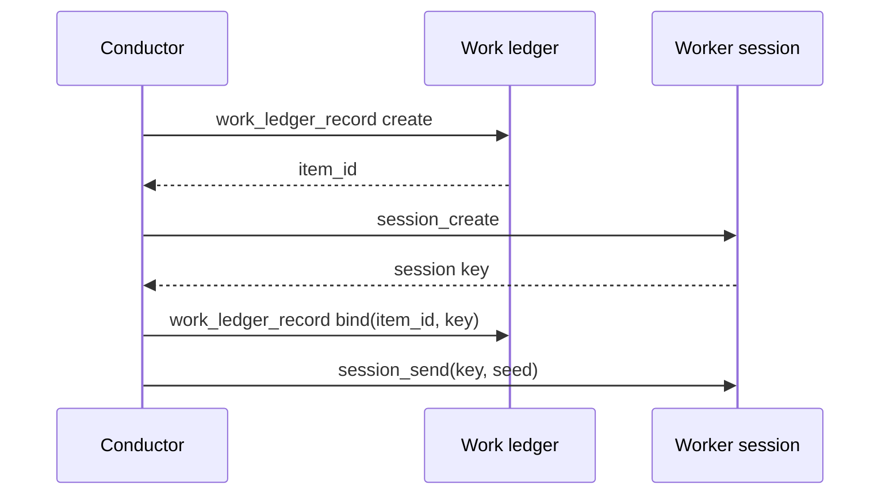

# RFC: One `work_dispatch` call creates, opens, binds and seeds a work item

Status: draft. Acceptance requested from the maintainer who owns the conductor patrol (iamwhatever). This answers open question Q1 of [rfc-conductor-work-ledger.md](rfc-conductor-work-ledger.md) ("Should `session_create` create and bind the item in one call?"). Tracks [#24226](https://github.com/kirodotdev/KiroCrew/issues/24226). Every code reference below was read at `9d31193afe`.

## Summary

Add one tool, `work_dispatch`, on the `kirocrew-dashboard` server beside `session_create` and `session_send`. One call does what a conductor does today in four: `work_ledger_record action=create`, `session_create`, `work_ledger_record action=bind`, `session_send`. It returns the real `item_id` and worker session key, or names the step that failed and what it cleaned up. It answers only a caller whose agent also mounts `@kirocrew-work`, and it is not auto-approved: a conductor prompts once per item, as it prompts for `session_send` today. The four-step path stays as the documented fallback. `session_create`, `session_send` and the `kirocrew-work` server do not change.

## Motivation

The dispatch procedure in [`goal-conductor/SKILL.md`](../../src/kiro_crew/builtin_skills/goal-conductor/SKILL.md) (lines 170 to 186) and in the conductor prompts in [`spec_prompts.py`](../../src/kiro_crew/agent_parts/spec_prompts.py) (lines 87 and 410) is four calls, each needing the previous call's result:

Models often issue all four in one parallel batch. Then `bind` and `session_send` carry ids the model invented before the earlier replies came back. What stops the damage today, and what does not:

- `bind` refuses a key that names no open session (`unknown_worker_session`, `_refuse_unowned_worker` in [`work_ledger_conductor.py`](../../src/kiro_crew/dashboard/handlers/work_ledger_conductor.py) lines 539 to 628) and a session this conductor did not create (`worker_not_owned`, line 599). An invented key is refused. Item ids are random (`mint_item_id` in [`work_ledger_store.py`](../../src/kiro_crew/work_ledger_store.py) uses `secrets`), so an invented `item_id` is refused too.
- `session_send` has no binding admission gate. It reads a ledger hand-back through `read_send_handback` ([`session_control.py`](../../src/kiro_crew/dashboard/handlers/session_control.py) line 739) but never refuses because its target is unbound. A send that runs before, or without, a successful `bind` seeds a worker that runs unbound: its first `work_brief` answers `not_bound`, and its reports have nowhere to land. The parent RFC's §Binding lifecycle names this as the failure to avoid.

The skill already says "in exactly this order". A prompt cannot enforce ordering on a parallel batch, so the rule does not hold.

## Goals

- One conductor call dispatches one item, with no id the model has to carry between calls.
- The tool sends the seed only after `bind` returned success.
- Any failure names the step (`create`, `session_create`, `bind`, `seed`), the route's refusal code, and what the tool cleaned up.
- No new authority and no new unattended path: each step runs through the route the four-call path uses, as the same caller; only a caller that already holds `@kirocrew-work` can use it; and it is not auto-approved.

## Non-goals

- Changing `session_create`, `session_send`, `work_ledger_record`, or anything on `kirocrew-work`.
- Auto-approving the tool (see Open questions).
- Batch dispatch of several items in one call. A round is a loop of `work_dispatch` calls.
- Removing the four-step path. A rebind onto an existing session (`goal-conductor/SKILL.md` line 463) and debugging still need it.
- Crew-member DM dispatch. Member specs mount `@kirocrew-dashboard` without `@kirocrew-work` and auto-approve `session_create` and `session_send` (`_MEMBER_DASHBOARD_GRANTS`, [`spec_grants.py`](../../src/kiro_crew/agent_parts/spec_grants.py) lines 298 to 303). They keep a ledger-free create-and-send, and `work_dispatch` refuses them.

## Design

### Placement

`work_dispatch` is a `kirocrew-dashboard` tool, defined in [`mcp_dashboard_session_tools.py`](../../src/kiro_crew/mcp_dashboard_session_tools.py) with its runner beside `_run_session_create` in [`mcp_dashboard_session_runs.py`](../../src/kiro_crew/mcp_dashboard_session_runs.py). It cannot live on `kirocrew-work`, for two reasons:

- `kirocrew-work`'s charter is that nothing on it reaches `enqueue_or_run_prompt` ([`mcp_work.py`](../../src/kiro_crew/mcp_work.py) lines 8 to 15; parent RFC §Non-goals "Not delivery"). A seed is a prompt.
- Every `kirocrew-worker` mounts `@kirocrew-work` ([`worker_agent.py`](../../src/kiro_crew/agent_materialization/worker_agent.py) line 821), and `kirocrew-dashboard` is kept off workers so that a worker cannot reach `session_send` by construction (same file, lines 412 to 418). On `kirocrew-work`, a worker would gain a verb that opens and seeds sessions.

Placement on `kirocrew-dashboard` must not hand the ledger to sessions that never had it. `/api/work-ledger/record` checks the caller's session key, not which server sent the request ([`work_ledger_caller.py`](../../src/kiro_crew/dashboard/handlers/work_ledger_caller.py) lines 51 to 95), and `action=create` opens a ledger for any such caller. So `work_dispatch` first checks that the caller's agent spec mounts `@kirocrew-work`, and refuses with `work_ledger_not_mounted` otherwise. The tool then reaches exactly the sessions that already hold `session_create`, `session_send` and `work_ledger_record`.

### Steps

The runner calls the existing gateway routes in order, as the caller, and reads their JSON replies (not the rendered text `_run_session_create` returns, so the folder walk and create call are factored into a helper that returns the structured response):

| Step | Route | On refusal |
|---|---|---|
| 1 create | `POST /api/work-ledger/record` `action=create` | stop; nothing to clean up |
| 2 open | the `session_create` folder walk plus `POST /api/session-control/create` | close the step-1 item (`action=close`, `state=abandoned`) |
| 3 bind | `POST /api/work-ledger/record` `action=bind` | close the step-2 session (`POST /api/session-control/close`), then the item |
| 4 seed | `POST /api/session-control/send` | no cleanup: the item is bound and the session exists |

Inputs: `title`, `acceptance` (as `action=create` takes them), `agent`, optional `agent_kind`, `folder`, `session_title` (defaults to `title`), `seed`, and the optional `model` / `reasoning_effort` that `session_create` takes. No input names a session: the seed target and cleanup target are only ever the `target` key step 2's reply returned. Output: `item_id`, `worker_session_key`, and on failure `failed_step`, the refusal code, and one outcome per cleanup action, with the ids of anything that survived.

Cleanup is best effort. A refused cleanup is reported, not retried. Folders the step-2 walk created are left in place, as `session_create` leaves them today when a later call fails.

A transport error after a request was sent leaves that step's outcome unknown, and the reply says so instead of calling it a refusal: `outcome_unknown` with the step name and whatever ids the tool already holds. After a lost step-1 or step-2 reply the tool has no id for what may have been created, so it sends nothing, cleans up only what it holds, and tells the conductor to read the board and sidebar. After a lost step-3 reply it sends nothing and cleans up as for a refused bind. After a lost step-4 reply it tells the conductor to check the session with `session_read_message` before resending, because a blind resend can seed twice.

### What is guaranteed

**The tool never seeds a session whose `bind` did not succeed.** A session that `session_create` opened is empty and idle until something sends to it. Only step 4 sends, and only after step 3 succeeded. A crash or refused cleanup after step 2 leaves at worst an idle, unseeded session and an open unbound item, both visible and neither running.

**What it does not guarantee.** A person can still act in the gap between step 3 and step 4: send into the new tab, or close the item from the Crew page. The conductor cannot, because the `item_id` and key are not returned to it until the tool finishes, and the conductor is its items' only writer. A person closing the item in that gap gets a seeded worker whose reports are refused `item_closed`, which the board shows. Closing that gap needs a binding admission check inside `session_send`, which is the ledger coupling Q1 avoids.

**Exact target.** Steps 3 and 4 and the cleanup pass the slot key step 2 returned. `_resolve_slot` in [`target_authorization.py`](../../src/kiro_crew/dashboard/session_control_parts/target_authorization.py) (line 553) also matches stems and titles, but refuses a string that matches two different slots, so a key that collides with another slot's title is a refusal rather than a wrong target. The tool runs only on approval, so a person sees the call before it acts.

### Why the MCP process orchestrates, not a new gateway route

Reusing the four routes keeps every existing check on its own path: the create rate limit, the goal's open-item cap (`goal_concurrency_cap_reached`, [`work_ledger_writes.py`](../../src/kiro_crew/work_ledger_writes.py) line 551), folder preflight, `bind`'s ownership and workspace fences, and the session-control audit records. One in-process gateway route would have to re-run each of those or call into handlers it does not own.

### Prompt and skill

`goal-conductor/SKILL.md` "Dispatch a round" and the conductor prompts in `spec_prompts.py` name `work_dispatch` as the dispatch path. The four steps stay in the skill as the fallback, with the rule that they run one call at a time.

## Migration plan

One implementation PR, under 600 lines: the tool, its input schema in the validation module, the structured create helper, the prompt and skill text, and tests.

Exit criteria:

- A refused `create` (for example `goal_concurrency_cap_reached`) opens no session and sends nothing.
- A refused `session_create` sends nothing, and the step-1 item is closed.
- A refused `bind` sends nothing, and the step-2 session and step-1 item are closed.
- A refused cleanup is reported with the surviving ids, and nothing was sent.
- A lost reply at any step is reported as `outcome_unknown` for that step, never as a refusal, and nothing is sent after a lost step 1, 2 or 3.
- A refused or lost seed returns both ids.
- A caller whose spec does not mount `@kirocrew-work` is refused `work_ledger_not_mounted` before step 1.
- Each failure reply names the failed step and the route's refusal code.
- The happy path returns the `item_id` and session key the routes returned.
- No `kirocrew-worker` spec can reach the tool.
- Tests synchronize on events, never on fixed sleeps.

## Backward compatibility

Additive. A conductor that never calls `work_dispatch` behaves as today. No grant is added. The conductor specs withhold `session_send` (`spec_grants.py` lines 205 to 207), so for them the new tool costs the same one prompt per item. Member specs are refused the tool (Non-goals).

## Security considerations

- No new authority: each step is an existing route called with the caller's own session key, so a refusal the caller would get calling the step directly it gets here. The `@kirocrew-work` check keeps a session that mounts only `kirocrew-dashboard` from gaining a ledger.
- No new unattended path: the tool is not auto-approved. A conductor prompts once per item, as it prompts once per `session_send` today, and the person reads the seed text in that prompt. `spec_grants.py` lines 205 to 207 give the reason that prompt exists: nothing bounds what `session_send` sends.
- Workers cannot reach it, because they do not mount `kirocrew-dashboard`.
- The seed target is produced by step 2, never chosen by the model.
- `kirocrew-dashboard` already carries the channel-agent block on its session-control tools; the new tool joins that list.

## Alternatives considered

- **Put it on `kirocrew-work`.** Rejected: that server must never deliver a prompt, and every worker mounts it (Placement above).
- **Fuse into `session_create(work_item=...)`**, Q1's original shape. Rejected: it couples `session_create` to the ledger for every caller, which the parent RFC names as the cost.
- **A `dispatch` action on `work_ledger_record`.** Rejected: a ledger verb on `kirocrew-work` that opens and seeds a session hits both Placement problems.
- **Refuse `session_send` to an unbound worker of a conductor.** `session_send` already reads the ledger for hand-backs, so the read is not new. What is new is a refusal: every send would have to decide whether its target is a worker-in-waiting, which a person's send into that tab, a member's send and a rebind all hit. It also leaves the model carrying ids across four calls, so a wrong-but-valid `item_id` from another of its own items still binds.
- **Prompt rule only.** Already in place; does not hold under parallel tool calls.

## Open questions

- Q1. Should conductors later auto-approve `work_dispatch`? Not proposed here. A grant would remove the one point where a person reads the seed, and the child inherits the caller's trust posture at creation. A board with no recorded goal has no goal concurrency cap (`work_ledger_writes.py` lines 541 to 545), only the per-conductor ceiling of 32 open items (`MAX_ITEMS_PER_CONDUCTOR`, [`work_ledger_records.py`](../../src/kiro_crew/work_ledger_records.py) line 123) and the create rate limit. A grant needs its own decision against those costs.
